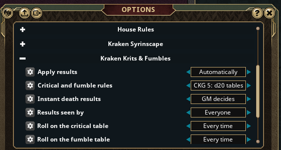

# Kraken Krits & Fumbles C&C

Critical hits and fumbles with a table for official Castles & Crusades (CnCRPG); SC C&C has it built into SiegeCore, applied in Fantasy Grounds Unity.

A natural 20 on an attack is a critical hit and a natural 1 a fumble (Castle Keeper's Guide, Chapter 17). The CK picks which of the book's optional rules is used:

- **Option 5** (default): Table 17.1A Critical Hits and 17.1B Critical Fumble, d20 each (knock down, teeth shattered, severed artery, limbs crippled... up to instant death).
- **Option 6**: crit d20 1-5 normal, 6-10 +1d4, 11-14 max damage, up to max x4; fumble d20 self damage, broken weapon, minimum damage, lost round.
- **Option 1**: crit = maximum damage +1d4 (+ strength modifier); fumble = dropped weapon or broken bow/string.
- **Option 4** (roadhouse): double the damage dice and double the bonus.

Instant death results are the CK's call by default (Options: Instant death results).

## What is applied

- Conditions and penalties go on the combat tracker as effects (prone, blinded, bleeding,
  attack and armour penalties, lost actions), with their duration.
- Extra damage and self damage are real damage rolls in chat, applied the ruleset's way.
- "Maximum damage", "extra die" and "double" results mark the attacker; its next damage roll
  is changed and the mark is removed.
- What Fantasy Grounds cannot track (dropped weapons, maiming, instant death) is announced to
  the GM in the same chat line.
- Player and GM rolls both work (the host applies the results).

## Options (Options > Kraken Krits & Fumbles)

| Option | Values |
| --- | --- |
| Critical and fumble rules | CKG Option 5 / 6 / 1 / 4 |
| Roll on the critical table | Off / Every time / 1 in 2 / 1 in 3 |
| Roll on the fumble table | Off / Every time / 1 in 2 / 1 in 3 |
| Apply results | Automatically / Chat only |
| Tables for | PCs and NPCs / PCs only |
| Results seen by | Everyone / GM only |
| Instant death results | GM decides / Apply |

`/krakenkrits crit [weapon]` and `/krakenkrits fumble [weapon]` roll a test result for the first two tracker
entries; `/krakenkrits tables` lists the tables.

Results print `[KRAKEN CRITICAL]` / `[KRAKEN FUMBLE]`, which the Kraken Syrinscape extensions play a sound for.

## Install

Copy `KrakenKritsCC` into the Fantasy Grounds `extensions` folder and tick it for a official Castles & Crusades (CnCRPG); SC C&C has it built into SiegeCore campaign.
